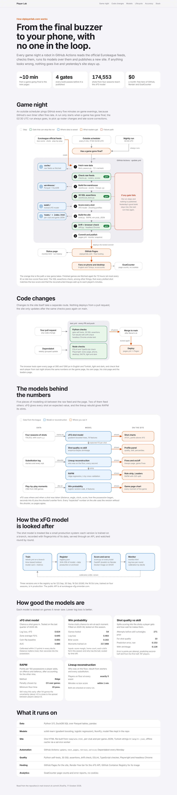

# Infrastructure

How the app runs, on one page: the game-night pipeline and its gates, the checks every code change passes, the five
models behind the numbers (xFG, shot quality vs skill, lineup reconstruction, RAPM, win probability), how the xFG model
is trained, registered, served and monitored, and what it all runs on.

- Open [`index.html`](index.html) in a browser for the full page (light and dark, phone and desktop). Pages serves it
  at https://elplayerlab.com/Infrastructure/
- [`architecture.png`](architecture.png) is a snapshot of the same page for viewing on GitHub.

Drawn from the repository at commit 2fce01a (17 October 2026). Update it when a workflow, gate or model changes.

